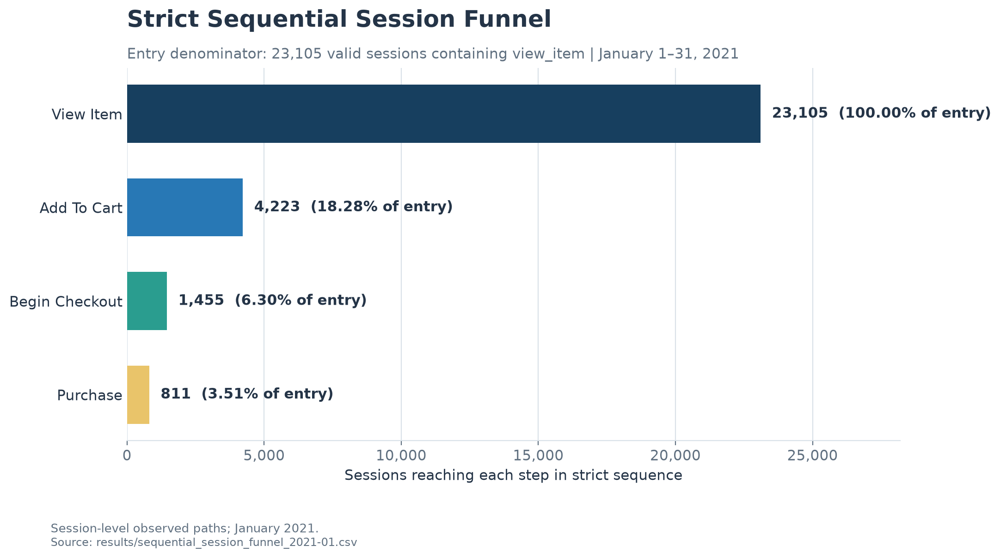

# GA4 Ecommerce Analytics and Predictive Analysis Prototype

A BigQuery SQL analysis of observed ecommerce session paths, with validated funnel metrics, device comparisons, timestamp sensitivity checks, and a proposed A/B test.

## Predictive analytics and LLM extension

An executable Python extension adds landmark-based session features, Logistic Regression
and LightGBM evaluation, SHAP explanations, segment summaries, and an LLM-driven,
read-only SQL analysis workflow. See [setup, commands, and evaluation](docs/predictive_platform.md).

**Evidence status:** real GA4 model training and live LLM evaluation are pending event
export and credentials. Synthetic model tests and offline gold SQL regression do not
establish real prediction performance or LLM accuracy. This is a CLI prototype.
The original validated descriptive findings below remain the recorded evidence.

```bash
pip install -e '.[dev]'
python -m pytest -q
python -m ga4_platform.cli evaluate-agent
```

## Data source and scope

This project uses Google's public [GA4 obfuscated ecommerce sample](https://developers.google.com/analytics/bigquery/web-ecommerce-demo-dataset) for the Google Merchandise Store. The recorded queries cover January 1–31, 2021 and six shopping events: `view_item`, `add_to_cart`, `begin_checkout`, `add_shipping_info`, `add_payment_info`, and `purchase`.

The primary path is a session-level sequence: `view_item → add_to_cart → begin_checkout → purchase`. A valid session key combines `user_pseudo_id` and `ga_session_id`; every selected step must occur strictly later than the preceding selected step. See the [metric definitions](docs/metric_definitions.md) for complete rules and unit distinctions.

## Key findings

- **23,191 valid sessions** contained at least one of the six shopping events. The strict funnel entry is a different population: **23,105 sessions** containing `view_item`.
- The strict observed path is **23,105 → 4,223 → 1,455 → 811**. Complete strict paths represent **3.5101% of entry sessions**; this is not a site-wide purchase conversion rate.
- There were **1,115 sessions containing purchase**: **811** had the complete strict path and **304** did not. The latter are incomplete observed paths, not abandoned carts.
- The relaxed same-timestamp comparison produces **3.5923%**, only **0.0822 percentage points** above the strict result. Desktop, mobile, and tablet complete-path rates are approximately **3.32%**, **3.78%**, and **3.78%**, respectively; these are descriptive, not causal comparisons.



## Recommended next steps

1. Verify instrumentation and observed-path coverage between `view_item` and `add_to_cart`, the largest absolute gap overall and within every recorded device category.
2. Assess product-detail pages and conduct targeted user research where needed before attributing the pattern to a design issue.
3. Do not preselect mobile as the problem device; review device results as descriptive diagnostics and account for the smaller tablet entry sample.
4. Only after those checks, decide whether a delivery-and-returns information treatment is relevant enough to test.

## Decision and experiment artifacts

- [Decision memo](reports/decision_memo.md) — product-facing interpretation and recommended actions.
- [Device conversion chart](reports/figures/device_conversion.svg) — strict complete-path conversion by device ([PNG](reports/figures/device_conversion.png)).
- [Timestamp sensitivity chart](reports/figures/timestamp_sensitivity.svg) — strict `>` versus relaxed `>=` ([PNG](reports/figures/timestamp_sensitivity.png)).
- [Product Detail Page Add-to-Cart Experiment Proposal](docs/ab_test_proposal.md) — **Proposal only — not executed.** The observational results motivate a hypothesis; they do not validate the proposed change.

## What this project demonstrates

- Translating GA4 event exports into explicit event-, user-, and session-level metrics.
- Building a strict sequential session funnel that selects the earliest qualifying event after each preceding step.
- Reconciling overall, device-grouped, timestamp-sensitivity, and purchase-path aggregate results.
- Separating observational evidence from a causal experiment proposal, with eligibility, intent-to-treat analysis, guardrails, and sample-size planning.
- Communicating analytical findings through reproducible charts and a concise product decision memo.

A resume-safe summary is available in [resume evidence](docs/resume_evidence.md).

## SQL and recorded results

| Analysis | SQL | Recorded aggregate result | Status |
|---|---|---|---|
| Six-event coverage | [01_event_coverage.sql](sql/01_event_coverage.sql) | [event_coverage_2021-01.csv](results/event_coverage_2021-01.csv) | Executed result recorded |
| Identity and session-key quality | [02_user_session_quality.sql](sql/02_user_session_quality.sql) | [user_session_quality_2021-01.csv](results/user_session_quality_2021-01.csv) | Executed result recorded |
| Strict sequential funnel and diagnostics | [03_sequential_session_funnel.sql](sql/03_sequential_session_funnel.sql) | [sequential_session_funnel_2021-01.csv](results/sequential_session_funnel_2021-01.csv), [timestamp_tie_diagnostics_2021-01.csv](results/timestamp_tie_diagnostics_2021-01.csv), [purchase_path_diagnostics_2021-01.csv](results/purchase_path_diagnostics_2021-01.csv) | Executed results recorded |
| Timestamp sensitivity | [04_timestamp_sensitivity.sql](sql/04_timestamp_sensitivity.sql) | [timestamp_sensitivity_2021-01.csv](results/timestamp_sensitivity_2021-01.csv) | Executed result recorded |
| Device assignment, funnel, and purchase coverage | [05_device_session_funnel.sql](sql/05_device_session_funnel.sql) | [device_assignment_quality_2021-01.csv](results/device_assignment_quality_2021-01.csv), [device_session_funnel_2021-01.csv](results/device_session_funnel_2021-01.csv), [device_purchase_path_coverage_2021-01.csv](results/device_purchase_path_coverage_2021-01.csv) | Executed results recorded |
| Product-page experiment | — | [A/B test proposal](docs/ab_test_proposal.md) | Proposal only — not executed |

The event-coverage CSV contains independent event-row counts and distinct user counts. Those totals must not be read as a sequential funnel. The identity-quality result records 121,524 shopping-event rows, zero missing `user_pseudo_id` or `ga_session_id` values in that scope, and 23,191 valid shopping sessions.

## Reproduction

The SQL files target `bigquery-public-data.ga4_obfuscated_sample_ecommerce.events_*` with `_TABLE_SUFFIX BETWEEN '20210101' AND '20210131'`. Run each query in BigQuery and export its result sets to the corresponding filenames above.

Charts are generated only from the recorded aggregate CSV files:

```bash
python3 -m venv .venv
.venv/bin/pip install -r requirements.txt
.venv/bin/python scripts/plot_results.py
```

The script validates that device step totals reproduce the overall funnel, device purchase coverage reconciles, and device assignments reproduce the valid-shopping-session total. It writes SVG and PNG files to `reports/figures/`.

## Limitations

- The source is an obfuscated public sample for one store and one month; it is not current first-party business data.
- Paths are session-level and may join events from different products. This is not a same-SKU funnel.
- Month boundaries, cross-session purchases, missing or delayed events, and strict timestamp ordering may reduce observed path completeness.
- “No observed next step” does not mean genuine user loss. The 304 purchase sessions without a complete observed strict path are not cart abandonment.
- The relaxed `>=` result cannot establish the order of equal-timestamp events.
- Device differences are descriptive and do not prove significance or causality. Sample conversion rates cannot predict enterprise revenue or experiment lift.
